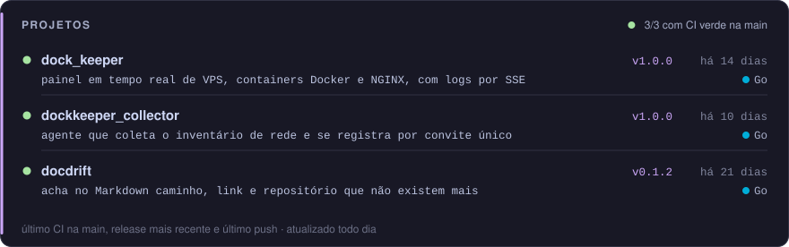
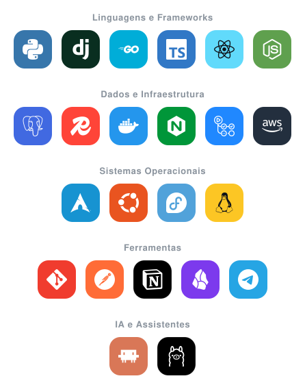
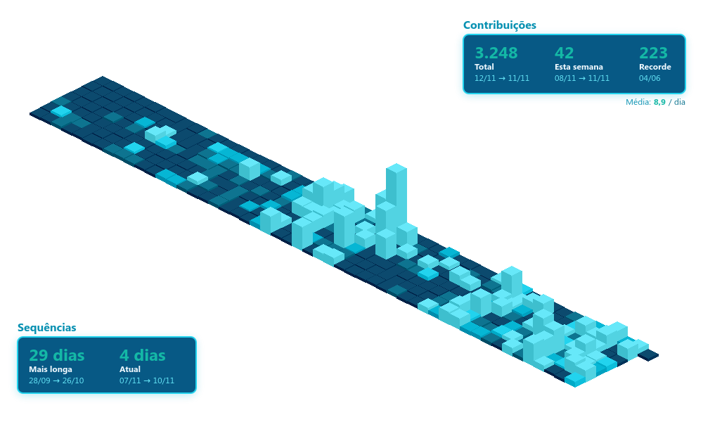

  

 

---

<h3 align="center">Projetos</h3>

  

 

---

<h3 align="center">Tecnologias e Ferramentas</h3>

  

 

---

<h3 align="center">Contribuições</h3>

  
   
  

 

---

<h3 align="center">Contato</h3>

  
  
  
  

